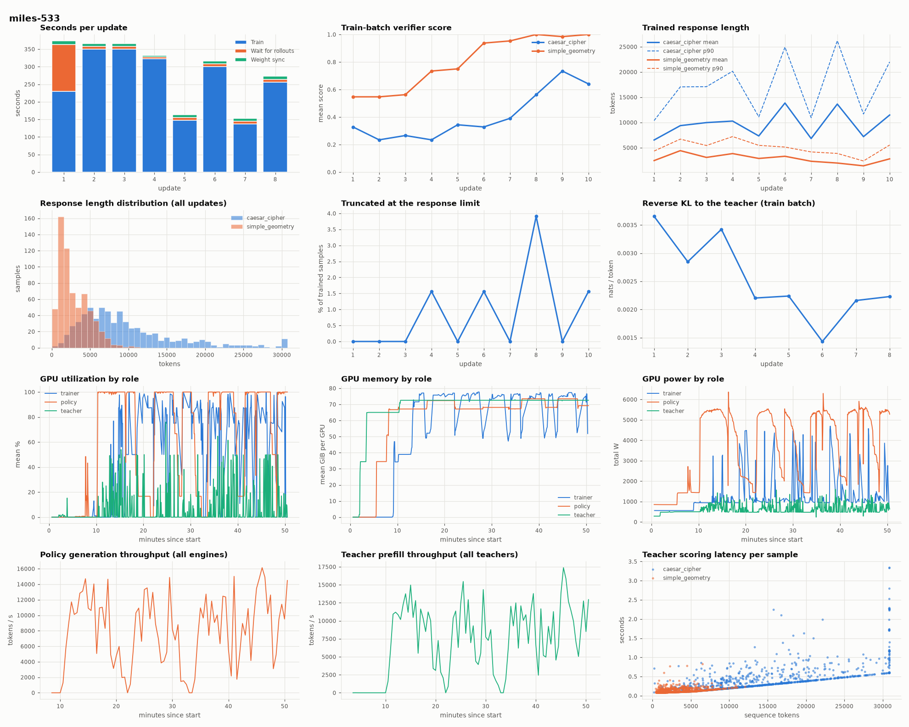

# MOPD on Miles, 24 H100 80 GB (CoreWeave): in progress

Two-teacher MOPD (`caesar_cipher`, `simple_geometry`) on Miles with the `h100x3` layout ([setup](SETUP.md#h100-layout-h100x3-miles-only)), run 533 on CoreWeave yolo-new, started 2026-10-07 14:11 UTC. The comparison is the B200 Miles run 1042 (16 B200, 2026-09-29; data in [`mopd-2026-09-29/data`](mopd-2026-09-29/data)). Single observations; the layouts, hardware and Miles settings differ (see [the Miles notes](../frameworks/README.md#miles)).

Status: 10 of 20 updates done. Checkpoint benchmarks (step 10 and 20) and the base and teacher references run after training and will be added to [`mopd-h100-2026-10-07/`](mopd-h100-2026-10-07).

## Layout

| | B200 run 1042 | H100 run 533 |
|---|---|---|
| Trainer | 8 B200, Megatron EP8 | 8 H100, Megatron TP2 + SP, EP8, CPU Adam |
| Policy | 6 GPUs, 3 TP2 engines | 12 GPUs, 6 TP2 engines over 2 nodes |
| Teachers | 1 GPU each | 2 GPUs each (TP2) |
| In-flight samples | 256 | 160 |
| Domain balance | Evicts surplus finished samples | Submits the task with fewer pending; keeps surplus |
| Online eval | Steps 0, 10, 20 | Step 20 only |

## Per update, first 8 updates (seconds)

| Update | H100 step | H100 train | H100 wait | B200 step | B200 train | B200 wait |
|---|---|---|---|---|---|---|
| 1 | 364 | 230 | 134 | 650 | 259 | 392 |
| 2 | 358 | 350 | 8 | 57 | 54 | 3 |
| 3 | 358 | 349 | 9 | 114 | 110 | 4 |
| 4 | 327 | 323 | 5 | 46 | 42 | 3 |
| 5 | 156 | 148 | 8 | 48 | 18 | 29 |
| 6 | 308 | 300 | 8 | 146 | 41 | 105 |
| 7 | 145 | 137 | 8 | 95 | 39 | 56 |
| 8 | 264 | 256 | 9 | 85 | 19 | 67 |
| Sum | 2,280 | | | 1,241 | | |

- On H100 the rollouts keep up: after update 1 the trainer waits 5-9 s per update, against 29-105 s on B200 from update 5. With twelve policy GPUs, the domain-balance fix and a slower trainer, the bottleneck is now the trainer.
- The H100 trainer trains 2,400-4,500 tokens/s (8 GPUs), several times slower than the B200 trainer. It needs TP2 and CPU Adam to fit 32k-token micro-batches in 80 GB (peak 79 GiB), and its data-parallel ranks finish unevenly on long sequences.
- Run 532 (stopped after 3 updates) had about 60 s per update with every trainer GPU idle: Ray gives each actor one OpenMP thread, so CPU Adam ran on one core per rank. Run 533 gives each rank 16 threads; the gap is now 5-10 s.
- Update 1 waited 134 s for its first batch on H100 against 392 s on B200 (where the step-0 evaluation also ran).

## Train-batch verifier score

| Update | H100 caesar | H100 geometry | B200 caesar | B200 geometry |
|---|---|---|---|---|
| 1 | 0.33 | 0.55 | 0.25 | 0.47 |
| 5 | 0.34 | 0.75 | 0.33 | 0.81 |
| 8 | 0.56 | 1.00 | 0.69 | 1.00 |
| 10 | 0.64 | 1.00 | 0.70 | 1.00 |

Mean trained response length is about 10,000 tokens for caesar_cipher (p90 up to 26,000) and 2,000-4,000 for simple_geometry; up to 4% of trained samples hit the 30,720-token limit.

`tools/plot.py RESULT_DIR OUT` draws this dashboard from files every run already writes: per-update timing, score, response length and truncation, reverse KL, GPU utilization, memory and power by role (trainer, policy, teacher), policy generation and teacher prefill throughput, and teacher latency per sample.

## B200 benchmark for reference

Run 1042, `tools/benchmark.py` (8 samples per dev prompt, temperature 1):

| Checkpoint | caesar avg@8 | geometry avg@8 |
|---|---|---|
| After 10 updates | 0.708 | 0.997 |
| After 20 updates | 0.769 | 0.996 |
