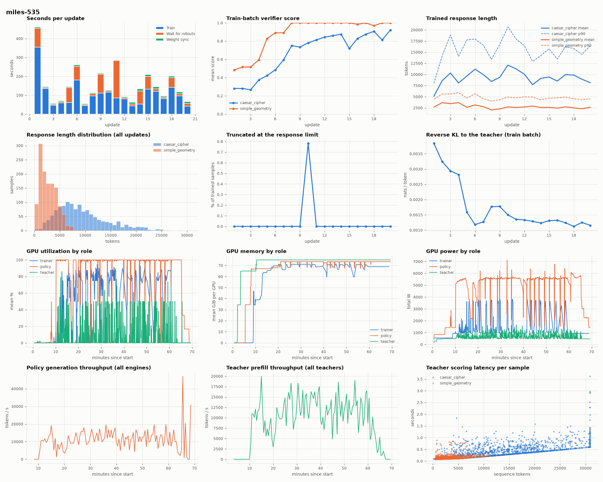

# MOPD on Miles, 24 H100 80 GB (CoreWeave)

Two-teacher MOPD (`caesar_cipher`, `simple_geometry`) on Miles with the `h100x3` layout ([setup](SETUP.md#h100-layout-h100x3-miles-only)), CoreWeave yolo-new, 2026-10-07. The reference run is B200 Miles run 1042 (16 B200, 2026-09-29, data in [`mopd-2026-09-29/data`](mopd-2026-09-29/data)). These are single observations, and the hardware, layouts and Miles settings differ (see [the Miles notes](../frameworks/README.md#miles)).

Data: [`mopd-h100-2026-10-07/data`](mopd-h100-2026-10-07/data) (benchmark `summary.json` files and `telemetry.json` for runs 533 and 535). Plots: [`mopd-h100-2026-10-07/plots`](mopd-h100-2026-10-07/plots).

## Summary

| | B200 run 1042 | H100 run 535 |
|---|---|---|
| GPUs | 16 B200 | 24 H100 80 GB |
| caesar_cipher avg@8, after 10 / 20 updates | 0.708 / 0.769 | 0.732 / 0.773 |
| simple_geometry avg@8, after 10 / 20 updates | 0.997 / 0.996 | 0.996 / 0.998 |
| Sum of the 20 update steps | 2,737 s | 2,924 s |
| Median update | 87 s | 123 s |
| Wall time, allocation start to end | 3,721 s | 4,184 s |
| Teacher prefill tokens per trained response token | 3.4 (47M / 14M) | 2.4 (37M / 15M) |

The student matches or beats both teachers on their own task: 0.773 against 0.703 on caesar_cipher, and 0.998 against 0.996 on simple_geometry. It ends level with the B200 run. With 24 H100 the 20 update steps took 7% longer than with 16 B200.

## Benchmarks

`tools/benchmark.py`: 8 samples per dev prompt (126 caesar_cipher, 128 simple_geometry), temperature 1, thinking on, up to 30,720 response tokens, four TP2 vLLM engines on 8 H100.

| Model | caesar avg@8 | caesar pass@8 | caesar truncated | simple_geometry avg@8 | simple_geometry pass@8 |
|---|---|---|---|---|---|
| Base Qwen3.6-35B-A3B | 0.270 | 0.643 | 4.3% | 0.553 | 1.000 |
| caesar_cipher teacher | 0.703 | 0.992 | 6.1% | 0.590 | 1.000 |
| simple_geometry teacher | 0.282 | 0.675 | 4.8% | 0.996 | 1.000 |
| Student, 10 updates (run 535) | 0.732 | 0.984 | 6.2% | 0.996 | 1.000 |
| Student, 20 updates (run 535) | **0.773** | 0.992 | 5.4% | **0.998** | 1.000 |
| B200 student, 20 updates (run 1042) | 0.769 | 1.000 | 6.4% | 0.996 | 1.000 |

Mean response length for the final student: 13,044 tokens on caesar_cipher and 2,877 on simple_geometry.

## Layout

| | B200 run 1042 | H100 run 535 |
|---|---|---|
| Trainer | 8 B200, Megatron EP8 | 8 H100, Megatron TP2 + SP, CP2, EP8, CPU Adam (16 threads per rank) |
| Policy | 6 GPUs, 3 TP2 engines | 12 GPUs, 6 TP2 engines over 2 nodes |
| Teachers | 1 GPU each | 2 GPUs each (TP2) |
| In-flight samples | 256 | 160 |
| Domain balance | Evicts surplus finished samples | Submits the task with fewer pending samples; keeps surplus |
| Online eval | Steps 0, 10, 20 | Step 20 only |

## Where the time goes (run 535)

| | Median | Total |
|---|---|---|
| Update step | 123 s | 2,924 s |
| Train | 91 s | 2,086 s |
| Wait for rollouts | 12 s | 838 s |
| Weight sync | 5.4 s | 131 s |

- **Trainer.** It is the larger cost. After update 1 (1,460 tokens/s) it trained 5,200-19,300 tokens/s on 8 GPUs, median about 10,000. Run 533, without context parallelism, managed 2,400-4,500.
- **Rollout waits.** Most updates wait 5-15 s. Updates 1, 5, 6, 9, 11, 14, 15 and 18 waited 50-200 s, when long caesar_cipher samples held the batch. Update 11's wait includes the step-10 checkpoint save.
- **Wall time outside the steps.** About 1,260 s: startup (Ray, engines and teachers, about 10 minutes), the final greedy evaluation and checkpoint saves.
- **Mean GPU utilization.**
  - Trainer: 25-43%, with uneven data-parallel ranks on long sequences.
  - Policy: 74-83%.
  - Teachers: 4-12%. A teacher only prefills, and it needs two 80 GB GPUs for its weights alone.
- **Energy.** 7.6 kWh of GPU energy in total.

## Runs before 535

| Run | Result | Change after it |
|---|---|---|
| 531 | The caesar_cipher teacher died at startup on `OSError: Stale file handle`. All three nodes shared one Triton cache on NFS | One kernel cache per role |
| 532 | About 60 s per update with every trainer GPU idle ([dashboard](mopd-h100-2026-10-07/plots/dashboard-miles-532.png)). Ray gives each actor one OpenMP thread, so CPU Adam ran on one core per rank. Stopped after 3 updates | 16 threads per trainer rank; the gap fell to 5-10 s |
| 533 | 14 updates, then `CUDA out of memory` in the backward pass of a full 32k-token sequence as responses grew (telemetry in `data/telemetry.json`) | Context parallelism 2, with 16,384 tokens per GPU and 32k per micro-batch |
| 535 | 20 updates, exit 0 | |

## Train-batch verifier score (run 535)

| Update | 1 | 5 | 10 | 15 | 20 |
|---|---|---|---|---|---|
| caesar_cipher | 0.28 | 0.42 | 0.78 | 0.72 | 0.92 |
| simple_geometry | 0.48 | 0.83 | 1.00 | 1.00 | 1.00 |

The reverse KL to the teacher fell from 0.0038 to 0.0012 nats per token. Trained caesar_cipher responses average 8,000-12,000 tokens (p90 13,000-21,000), and under 1% of trained samples hit the response limit. Samples that take more than about two updates to generate are dropped as stale at policy lag 1, so the trained batches lean toward shorter responses than the benchmark's (13,000 tokens mean).



`tools/plot.py RESULT_DIR OUT` draws this dashboard from files every run already writes. It shows per-update timing, score, response length and truncation, and reverse KL; GPU utilization, memory and power by role (trainer, policy, teacher); policy generation and teacher prefill throughput; and teacher latency per sample.

## Reproducing

On a Slurm login node with Pyxis, with a site file that names `generation_node_2` and `generation_ip_2`:

```bash
PARTITION=h100 SITE=site.json RUNS=/mnt/data/opd/runs RUNTIME=/mnt/data/opd/runtime SHARED=/mnt/data \
  DOMAINS="caesar_cipher simple_geometry" NAME=mopd-h100 LAYOUT=h100x3 BENCH_TP=2 \
  tools/reproduce.sh miles references
```
